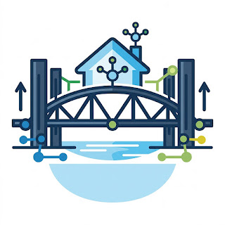

# NDW Dutch Bridges for Home Assistant

A custom Home Assistant integration structured as a HACS-compatible repository. This integration monitors moveable bridges (open/closed status) in the Netherlands using open data from the Dutch National Road Data Portal (NDW - Nationaal Dataportaal Wegverkeer) without requiring any API keys.

## Features

- **Strict Compliance with Home Assistant Standards**: Fully async, uses a `DataUpdateCoordinator` to poll the NDW API efficiently (every 5 minutes).
- **Config Flow**: No `configuration.yaml` required! Set up and configure bridges entirely through the Home Assistant UI.
- **Binary Sensor**: Represents the bridge state (Open/Closed) using the `door` device class.

## Installation

### Method 1: HACS (Recommended)

1. Open HACS in Home Assistant.
2. Go to **Integrations**.
3. Click the three dots in the top right corner and select **Custom repositories**.
4. Add the URL to this repository (`https://github.com/your-username/ha-dutch-bridges`) and select `Integration` as the category.
5. Click **Add**.
6. Find "NDW Dutch Bridges" in HACS and click **Download**.
7. Restart Home Assistant.

### Method 2: Manual Installation

1. Download this repository.
2. Copy the `custom_components/dutch_bridges` folder into your Home Assistant's `config/custom_components/` directory.
3. Restart Home Assistant.

## Configuration

1. In Home Assistant, go to **Settings** > **Devices & Services**.
2. Click **+ Add Integration** in the bottom right corner.
3. Search for "NDW Dutch Bridges" and select it.
4. Follow the configuration flow:
   - **Bridge ID**: Enter the NDW External Location Code for the bridge (e.g., `NLLRU002120533900259`). You can find these IDs in the NDW open data portals or by exploring the XML feed `https://opendata.ndw.nu/actueel_beeld.xml.gz`.
   - **Custom Name**: Enter a friendly name for the bridge (e.g., "Zuidhorn Bridge").
5. The integration will create a binary sensor for the bridge that reflects its open/closed state.

## Advanced Usage

To find bridge IDs, you can download the NDW feed (`https://opendata.ndw.nu/actueel_beeld.xml.gz`), extract it, and search for `bridgeSwingInOperation` events to find `externalLocationCode` identifiers for bridges you care about.

## Credits

Denne integrasjonen er laget av Jules. (This integration is created by Jules).
